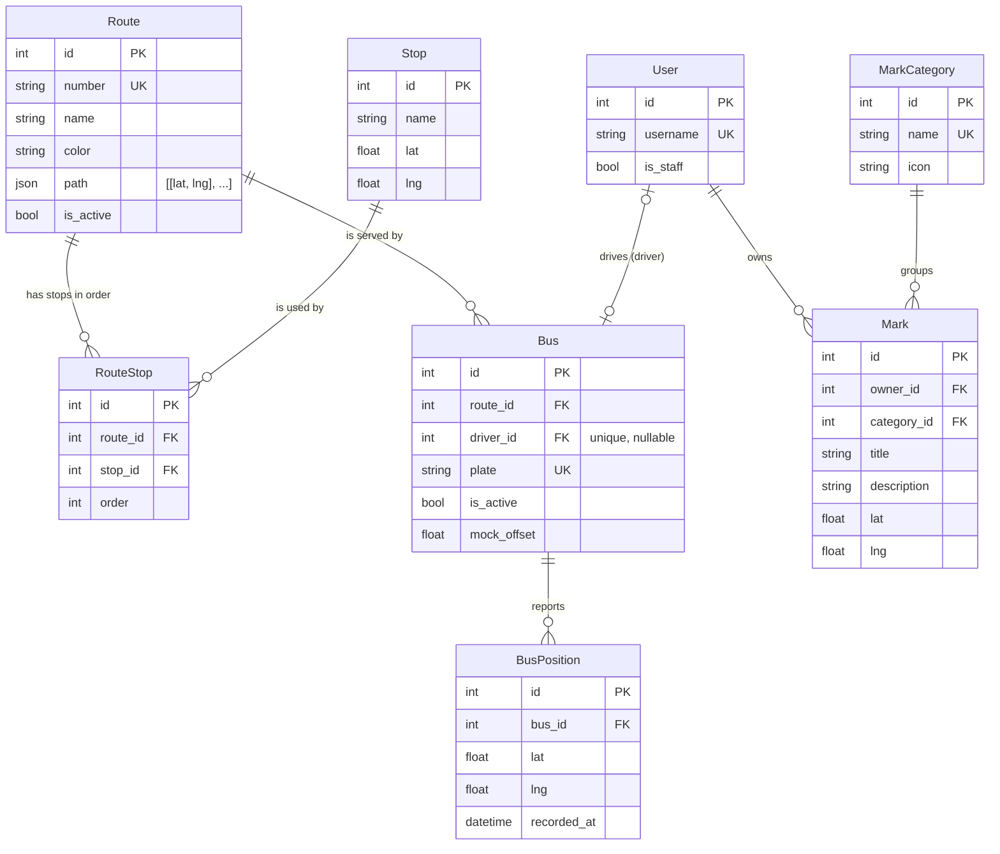

# Models and their relationships

The editable diagram is [`er-diagram.drawio`](er-diagram.drawio). Open it at <https://app.diagrams.net> or in the draw.io VS Code extension. The same diagram is below so it shows on GitHub.

## Relationships

| Relationship | Type | On delete | Why |
| --- | --- | --- | --- |
| Route ↔ Stop through `RouteStop` | many-to-many with an `order` column | cascade | A stop like "Center" is shared by several routes, and each route needs its own stop order. `UNIQUE (route, order)` stops two stops from taking the same place. |
| Route → Bus | one-to-many | cascade | A bus serves one route. |
| User → Bus (`Bus.driver`) | one-to-one, optional | set null | One driver drives one bus, and the unique column makes the database enforce it. Deleting the driver's account keeps the bus. From a user, `user.bus` gives their bus. |
| Bus → BusPosition | one-to-many | cascade | The GPS history of a bus. |
| User → Mark | one-to-many | cascade | Marks belong to their author. |
| MarkCategory → Mark | one-to-many | **protect** | A category that still has marks can't be deleted. The category admin pages will show a message for this. |

## Constraints and indexes added in migration `0002`

- `Bus.driver`: `OneToOneField(User, null=True)`, a unique column.
- `UNIQUE (Stop.name, Stop.lat, Stop.lng)` (`unique_stop_name_location`): the same stop is never stored twice. `RouteService` already reuses stops with `get_or_create`.
- `INDEX (BusPosition.bus, BusPosition.recorded_at)` (`busposition_bus_time_idx`): the map reads the latest position of every bus on each refresh.

## Inheritance

`Route`, `Stop`, `Bus` and `Mark` inherit `created_at` and `updated_at` from the abstract `TimeStampedModel`. Abstract means it has no table of its own: the fields are copied into each child table.
